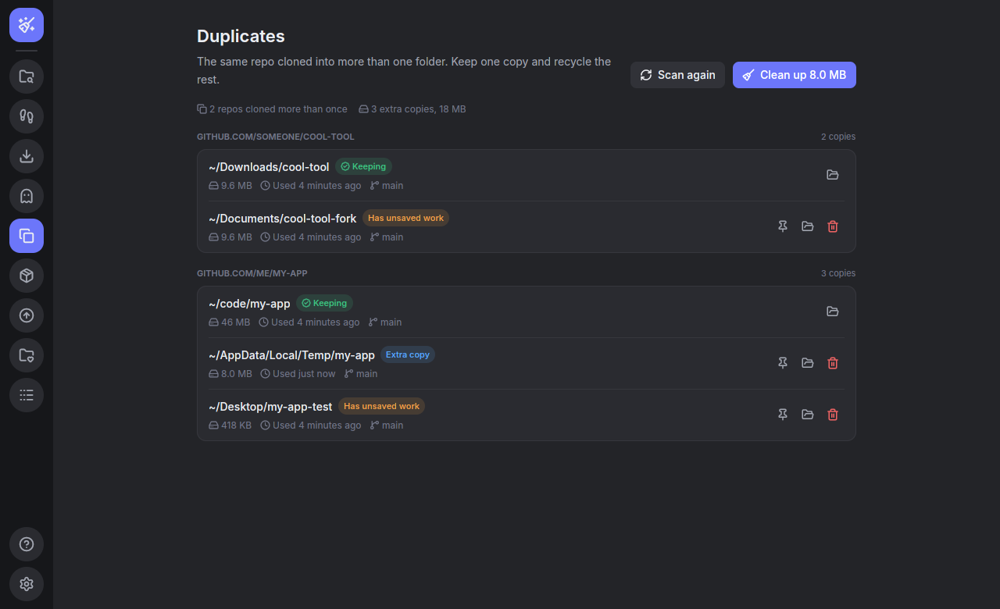

# Agent Cleanup

A small, fast Windows app that finds the clutter AI coding agents (Claude Code, Codex and friends) leave behind: repos cloned "for testing" into random folders, stale clones in Downloads or `%TEMP%`, and scratch projects that never made it into your real project folders.

It's written in Rust with [GPUI](https://www.gpui.rs), the GPU-accelerated UI framework behind the Zed editor, plus the [gpui-component](https://github.com/longbridge/gpui-kit) widgets. It's a single native `.exe` (about 20 MB) with no installer, web engine or runtime.


## How it works

1. **You add your project folders** on the Projects page. Repos inside them are yours and are left alone. Any repo found elsewhere is a possible leftover.
2. **It scans for repos** under your home folder, skipping dependency caches (`node_modules`, `target`, `.cargo` and so on) and everything in AppData except `AppData\Local\Temp`. Results are saved, so the app opens instantly next time.
3. **It checks what's unsaved** using git, read-only: uncommitted changes, commits that aren't on any remote, stashes, whether the repo has a remote at all, and files git ignores that nothing recreates (a `.env`, a local database, a `data/` folder). Those are never pushed, so even a fully pushed clone can hold the only copy. Ignored build output, dependencies, caches, logs and editor settings (`node_modules`, `target`, `__pycache__`, `*.log`, `.vscode`...) don't count.
4. **It gives each repo a status:**
   - **Safe to remove:** outside your projects, unused for a while (14 days by default), and everything is pushed.
   - **Has unsaved work:** outside your projects, but something in it exists only on this PC.
   - **Couldn't check:** git couldn't read it, often a half-copied repo or a worktree whose main repo is gone. The reason is shown, and it's treated like unsaved work. Ones in a temp folder are tagged **Temp folder**: those are almost always throwaway agent copies, and the page can select them all for you.
   - **Used recently:** outside your projects but used in the last few days.
   - **In a project:** inside one of your project folders.

The left rail switches between **Leftovers**, **Agent trail**, **Downloads**, **Agent data**, **Duplicates**, **Build junk**, **Updates**, **Projects**, **Activity** (everything the app moved or put back), **How this works** and **Settings**. On Leftovers, the sidebar filters by status and the cards at the top show how much space you can free. Click any repo to see what's unsaved and what to do about it, for example "Run `git push` to upload the 2 commits". Buttons there open the folder or a terminal in it.


## Agent trail

Claude Code and Codex log every session (`~/.claude/projects` and `~/.codex/sessions`). The **Agent trail** page reads the last 90 days of those logs, read-only, and lists what an agent made outside the folder it was working in: files it wrote, things it downloaded with `curl` or `wget`, and repos it cloned. Items are grouped by the project the agent was working on, with which agent did it and when.

Every item gets a verdict with a one-line reason: **Safe to clean** (the agent made it and nothing in it is unsaved), **Check first** (a clone with unsaved git work or one git can't read, a private-looking file, a file inside another repo that isn't one of your projects, a document the agent wrote such as a `.md` or `.pdf` report, or anything made in the last day) or **Probably yours** (a file the agent only *changed*, say your `.bashrc`, or one older than the session). The banner at the top says how much the safe items free and cleans them in one click; each group can also clean just its safe items. Cleaning never touches the agents' chat history.

Downloads, Agent data, Duplicates and Build junk work the same way: a verdict tag and reason on every item, and a banner that says what's safe and what you'd lose.


## Downloads

The **Downloads** page lists what arrived in your Downloads folder in the last 90 days and guesses which project each one was for, from what was going on when it landed:

- an agent session downloaded that exact file (always a match);
- you committed, checked out or pulled in a repo within two hours of it (read from `.git/logs/HEAD`);
- Claude Code or Codex was working in a project around then.

Closer events count more. A project needs a clear lead over the next one, otherwise the file goes under **No clear project** rather than getting a wrong guess. Each row says why it matched, like "You used git there 4 min before it arrived".

**Move into project** moves the file into the project's folder (it won't overwrite anything there, and won't copy across drives). It isn't offered for private-looking files such as a `.env` or a key, so they can't end up committed by accident. Undo moves it back. Installers (`.msi`, `.msix`, setup or install `.exe`) are marked **Safe to clean** once they're a week old; newer ones might not have been run yet. You can also recycle a download, hide it, or show it in File Explorer.


## Agent data

Claude Code and Codex keep every session's history (`~/.claude/projects`, `~/.claude/file-history` and `~/.codex/sessions`), and it stays behind after you delete the project. The **Agent data** page reads which folder each session ran in and lists the history of projects that no longer exist, with the number of sessions, size and when it was last used. Without the project those sessions can't be resumed.

A project on a drive or network share that isn't connected right now doesn't count as deleted. History used in the last week, or whose project name matches a folder that exists somewhere else (in your project folders or among the scanned repos), needs a tick first, in case the project only moved. **Clean up** leaves those out.


## Duplicates

The **Duplicates** page groups the repos the scan found by their remote, so `https://github.com/me/tool.git`, `git@github.com:me/tool` and `~/AppData/Local/Temp/tool` cloned by an agent all count as one repo. In each group one copy is kept: the one in a project folder, otherwise the most recently used. Pin another copy to keep that one instead.

**Clean up** recycles the extra copies that are outside your project folders and have nothing that exists only in that copy. A copy with uncommitted changes, unpushed commits, stashes or private ignored files is marked **Has unsaved work** and needs a tick before it can be recycled.



## Build junk

The **Build junk** page looks inside the repos the scan found for dependency and build folders: `node_modules`, Rust `target`, Python venvs, `dist`/`build`/`.next` and other framework caches, Gradle and .NET output, and Python tool caches. A folder is only listed when git ignores it *and* the file that rebuilds it is next to it (`package.json` beside `node_modules`, `Cargo.toml` beside `target`, `pyvenv.cfg` inside a venv). So a `build` folder that holds real source never shows up.

Each row says what brings it back (`npm install`, `cargo build`, ...). **Clean up** only takes folders from projects you haven't touched for the "stale" days set in Settings. Recycling one from a project you're still working on needs a tick first. Big folders move in the background so the window stays responsive. Windows refuses to recycle anything bigger than the Recycle Bin allows, so those stay where they are and the error says so. They are never permanently deleted.


## Updates

The **Updates** page shows outdated packages in your projects, using each tool's own check: `npm outdated`, `cargo update --dry-run` and `pip list --outdated` (in the project's venv). Only repos inside your project folders are checked, because checking runs their tools. Bigger updates that may need code changes (a new major version) are marked but left for you to do by hand.

**Update** opens a terminal in the project running `npm update`, `cargo update` or `pip install --upgrade ...`, so you can watch it and stop it. It only starts when git shows no uncommitted changes, so `git diff` shows exactly what the update changed and `git checkout .` undoes it.


## Weekly check

Turn on **Weekly check** in Settings and Windows Task Scheduler runs the app once a week (Mondays, or the next time the PC is on, never on battery) without opening a window. It scans like the app does and saves the results, then shows a notification if there's at least 100 MB or an old project copy to clean (including agent data for deleted projects), for example "2 old project copies safe to remove (300 MB), 1.2 GB of build folders in idle projects". Clicking it opens the app (the check waits up to an hour for that click, then exits). The check never moves anything, nothing stays running between checks, and it only counts things the app would mark safe. **Run now** tries it straight away. Turning the switch off removes the task. The app doesn't need to be open for the check to run. If you move or rename the exe, the next time you open it the task is pointed at the new location.

## Cleaning up

- **Clean up** recycles every repo marked safe in one go. You can also recycle one repo from its card (hover for the buttons), or tick several and choose **Recycle selected**.
- Recycling and Undo run in the background, so the window stays responsive while big folders move. A note at the bottom says what is being moved.
- **Undo** appears right after, and puts everything back where it was.
- **It's a project** tells the app a folder is your real work. **Hide** stops showing a repo (unhide it on the Projects page).
- Press Escape to close a dialog or the details panel.
- **Copy prompt for your agent** (on Leftovers views and on each group of the other pages) copies a ready-to-paste request for Claude Code or Codex: it lists those items with the app's notes and asks the agent to save unsaved work, explain what things are, or move files into their project. It tells the agent not to delete anything, and only includes paths and notes shown on the page, never remote URLs.

## Safety

- Nothing is ever permanently deleted. Recycle moves folders to the **Recycle Bin**.
- Every removal asks first. If any item has unsaved work, the dialog lists exactly what would be lost. When the selection is a mix, the main button recycles only the safe ones; taking the rest too needs a ticked box.
- Private-looking files (`.env`, keys, certificates, password stores, databases) are never cleaned in one click: in repos git ignores them in, in agent-made folders that aren't repos, in repos git can't read (so the Temp folder "select all" skips those) and in Downloads.
- The search for private-looking files stops after 50,000 entries or 8 folders deep. A folder that hits that limit is treated as not fully checked and needs a tick, never as "nothing private here".
- Ignored folders named `build`, `dist`, `out`, `bin`, `obj`, `target` or `vendor` only count as rebuildable when the matching build file is right beside them.
- If git can't read a repo, or can't count its unpushed commits or stashes, the app assumes it has unsaved work. It never guesses "safe".
- Scan results are saved between runs, so right before a repo that looked safe is recycled, git is read again. If it has gained unsaved work since the scan, it stays where it is and the app says so.
- Commits made without a branch (a "detached HEAD", common in agent checkouts) count as unsaved work.
- Every move and restore is written to `actions.log` in `%APPDATA%\agent-cleanup\config\`, next to `config.toml`, and shown on the Activity page.


## What it leaves on your PC

A cleanup tool shouldn't make its own mess, so here is everything Agent Cleanup writes, and nothing else:

| What | Where | When |
| --- | --- | --- |
| The app | wherever you put `agent-cleanup-<version>-windows-x64.exe` | You downloaded it. There's no installer, no registry entries, no Start menu shortcut and no background service. |
| `config.toml` | `%APPDATA%\agent-cleanup\config\` | Your settings: project folders, hidden repos, the stale days. A few KB. |
| `config.toml.bad` | same folder | Only if the settings file was ever damaged: the app keeps the damaged copy here and tells you, instead of losing your settings silently. |
| `last_scan.toml` | same folder | The last scan's results, so the app opens instantly. Replaced on every scan, never grows past one scan. |
| `actions.log` | same folder | One line per thing moved or put back, so there's always a record. |
| "Agent Cleanup weekly check" | Windows Task Scheduler | Only while **Weekly check** is on. Turning it off deletes the task. |
| `agent-cleanup.update.exe` | next to the exe | Only while an update downloads. Deleted when it's done or fails. |
| `.agent-cleanup.*.__relocated__.exe` and similar | next to the exe, then `%TEMP%` | The old exe while an update swaps it out. Windows deletes it as the old copy exits. |
| `agent-cleanup-task.xml` | `%TEMP%` | For a moment while turning the weekly check on. Deleted right away. |

If the app is killed in the middle of an update or while turning the weekly check on, the temporary files above can stay behind. The next time it starts, it deletes any that are more than 10 minutes old. Only files with exactly these names are touched.

Two things are Windows' own, not the app's: whatever you recycle sits in the **Recycle Bin** until you empty it (that's what makes Undo work), and weekly check notifications appear under Windows PowerShell in the notification center, because Windows needs a registered app to show them and the app doesn't register itself.

**Remove all app data** in Settings deletes the task, the config folder and any leftover temp files in one go (after asking), then closes the app. Delete the exe afterwards and nothing of Agent Cleanup is left.

## Getting the app

**Download:** get `agent-cleanup-<version>-windows-x64.exe` from the [latest release](../../releases/latest) and run it. Windows SmartScreen may warn you the first time because the file isn't code-signed. Click **More info**, then **Run anyway**.

You also need [Git for Windows](https://git-scm.com/download/win) on your `PATH`.

**Updates:** the app checks for a new release when it starts (you can turn this off in Settings). When one is available, click **Update now** and it downloads the new version, checks it against the SHA-256 GitHub lists for that release, swaps it in, and offers to restart.

**Build it yourself** with [Rust](https://rustup.rs):

```powershell
cargo run --release
```

On Linux you also need `libxkbcommon-dev`, `libxkbcommon-x11-dev` and `libwayland-dev`.

## Releasing

Bump `version` in `Cargo.toml` and merge to `main`. The Release workflow builds the .exe on Windows and publishes it as `vX.Y.Z`, and installed copies offer the update.

## Roadmap

Code signing, so Windows SmartScreen stops warning on first run. It needs a paid code signing certificate.

## Development

```powershell
cargo test                                  # needs git on PATH
cargo test -- --ignored                     # also hits the real GitHub API
cargo clippy --all-targets -- -D warnings
cargo fmt
```

The core logic (`src/config.rs`, `git.rs`, `model.rs`, `scan.rs`, `cache.rs`, `actions.rs`, `update.rs`, `library.rs`, `activity.rs`, `trail.rs`, `junk.rs`, `deps.rs`, `downloads.rs`, `check.rs`, `schedule.rs`, `agentdata.rs`, `dupes.rs`, `footprint.rs`, `private.rs`, `prompts.rs`, `jobs.rs`) has no UI code and is unit tested. `background.rs` is the weekly check, run with `--check`. The window lives in `src/ui/`: `app.rs` (state and actions), one file per page (`leftovers.rs`, `trail.rs`, `downloads.rs`, `agentdata.rs`, `dupes.rs`, `junk.rs`, `updates.rs`, and `pages.rs` for the rest plus the dialogs), `details.rs`, `widgets.rs`, `theme.rs` (palette) and `assets.rs` (fonts and icons).

## License

[MIT](LICENSE). The bundled Inter font is under the SIL Open Font License.
