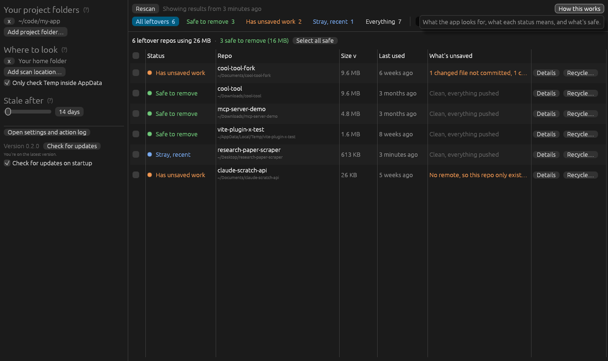
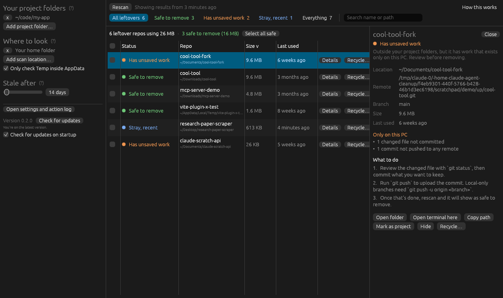
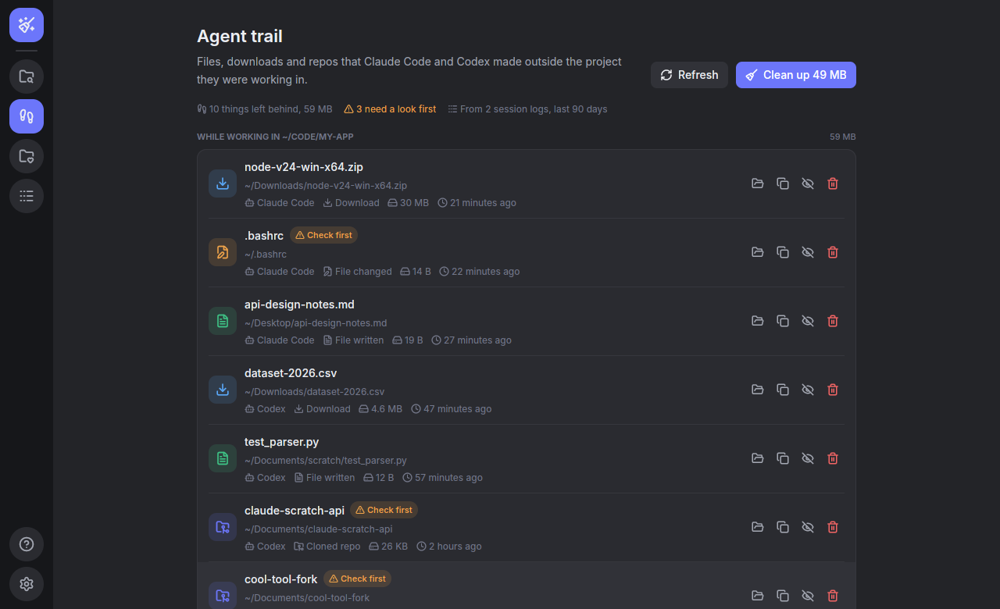
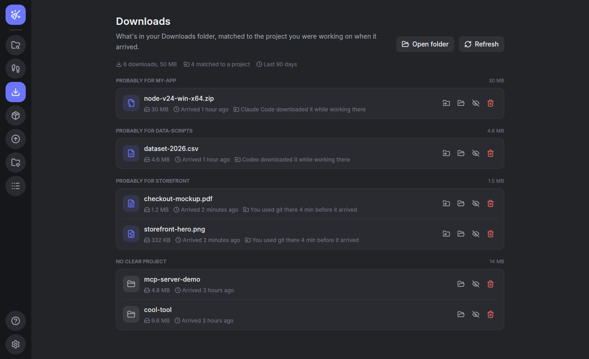
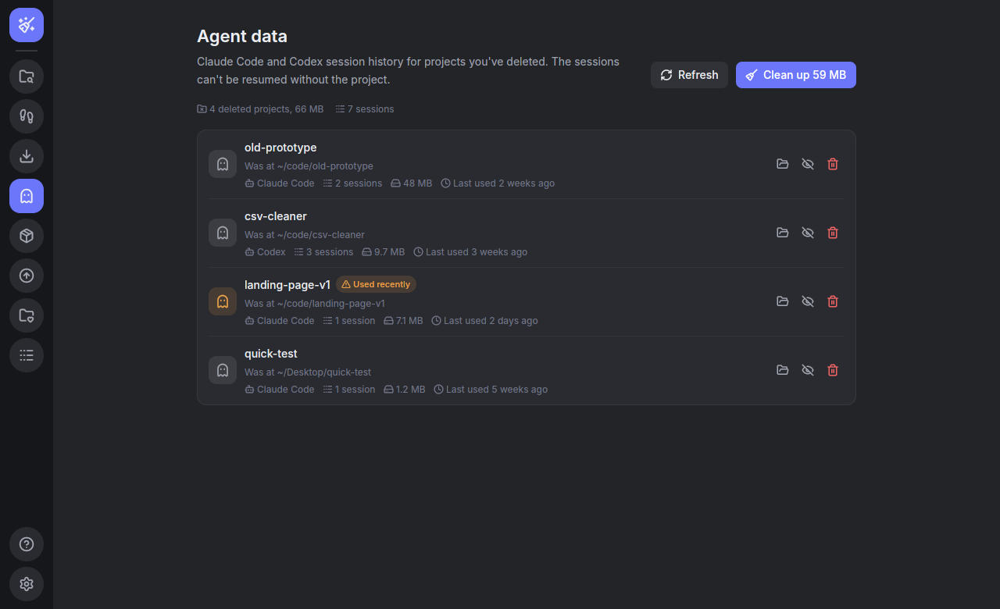
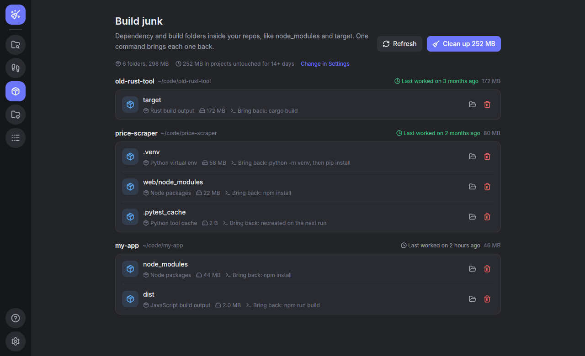
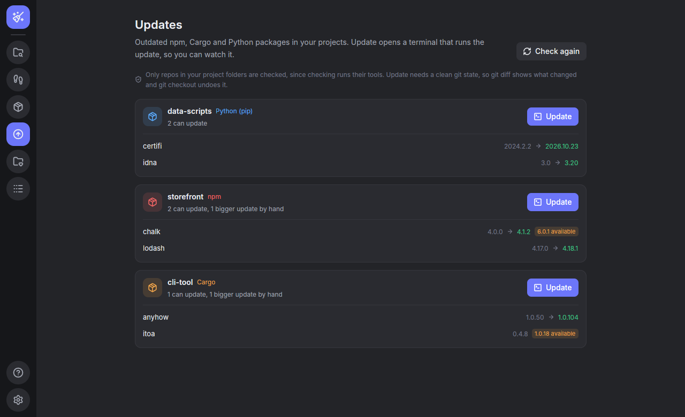
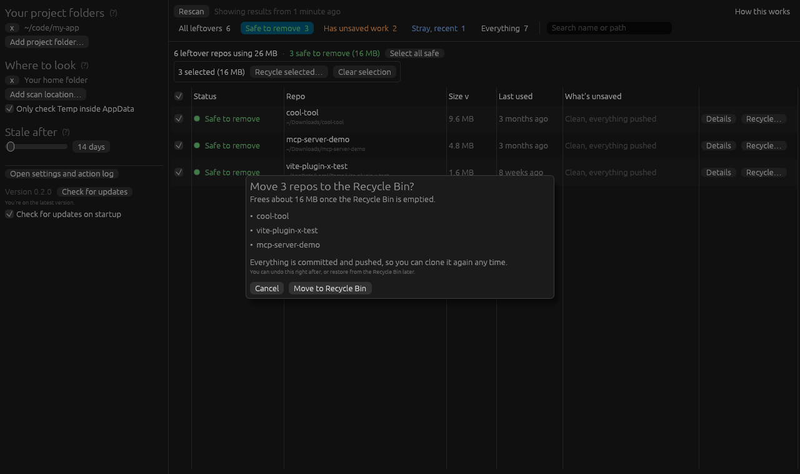

# Agent Cleanup

A small, fast Windows app that finds the clutter AI coding agents (Claude Code, Codex and friends) leave behind: repos cloned "for testing" into random folders, stale clones in Downloads or `%TEMP%`, and scratch projects that never made it into your real project folders.

It's written in Rust with [GPUI](https://www.gpui.rs), the GPU-accelerated UI framework behind the Zed editor, plus the [gpui-component](https://github.com/longbridge/gpui-kit) widgets. It's a single native `.exe` (about 30 MB) with no installer, web engine or runtime.



## How it works

1. **You add your project folders** on the Projects page. Repos inside them are yours and are left alone. Any repo found elsewhere is a possible leftover.
2. **It scans for repos** under your home folder, skipping dependency caches (`node_modules`, `target`, `.cargo` and so on) and everything in AppData except `AppData\Local\Temp`. Results are saved, so the app opens instantly next time.
3. **It checks what's unsaved** using git, read-only: uncommitted changes, commits that aren't on any remote, stashes, and whether the repo has a remote at all.
4. **It gives each repo a status:**
   - **Safe to remove:** outside your projects, unused for a while (14 days by default), and everything is pushed.
   - **Has unsaved work:** outside your projects, but something in it exists only on this PC.
   - **Stray, recent:** outside your projects but used recently.
   - **In a project:** inside one of your project folders.

The left rail switches between **Leftovers**, **Agent trail**, **Downloads**, **Agent data**, **Build junk**, **Updates**, **Projects**, **Activity** (everything the app moved or put back), **How this works** and **Settings**. On Leftovers, the sidebar filters by status and the cards at the top show how much space you can free. Click any repo to see what's unsaved and what to do about it, for example "Run `git push` to upload the 2 commits". Buttons there open the folder or a terminal in it.



## Agent trail

Claude Code and Codex log every session (`~/.claude/projects` and `~/.codex/sessions`). The **Agent trail** page reads the last 90 days of those logs, read-only, and lists what an agent made outside the folder it was working in: files it wrote, things it downloaded with `curl` or `wget`, and repos it cloned. Items are grouped by the project the agent was working on, with which agent did it and when.

Files an agent only *changed* (say, your `.bashrc`), files that are older than the session, and clones with unsaved git work are marked **Check first**. They need a tick before they can be recycled, and **Clean up** leaves them out.



## Downloads

The **Downloads** page lists what arrived in your Downloads folder in the last 90 days and guesses which project each one was for, from what was going on when it landed:

- an agent session downloaded that exact file (always a match);
- you committed, checked out or pulled in a repo within two hours of it (read from `.git/logs/HEAD`);
- Claude Code or Codex was working in a project around then.

Closer events count more. A project needs a clear lead over the next one, otherwise the file goes under **No clear project** rather than getting a wrong guess. Each row says why it matched, like "You used git there 4 min before it arrived".

**Move into project** moves the file into the project's folder (it won't overwrite anything there, and won't copy across drives). Undo moves it back. You can also recycle a download, hide it, or show it in File Explorer.



## Agent data

Claude Code and Codex keep every session's history (`~/.claude/projects`, `~/.claude/file-history` and `~/.codex/sessions`), and it stays behind after you delete the project. The **Agent data** page reads which folder each session ran in and lists the history of projects that no longer exist, with the number of sessions, size and when it was last used. Without the project those sessions can't be resumed.

A project on a drive or network share that isn't connected right now doesn't count as deleted. History used in the last week is marked **Used recently** and needs a tick first, in case the project only moved. **Clean up** leaves those out.



## Build junk

The **Build junk** page looks inside the repos the scan found for dependency and build folders: `node_modules`, Rust `target`, Python venvs, `dist`/`build`/`.next` and other framework caches, Gradle and .NET output, and Python tool caches. A folder is only listed when git ignores it *and* the file that rebuilds it is next to it (`package.json` beside `node_modules`, `Cargo.toml` beside `target`, `pyvenv.cfg` inside a venv). So a `build` folder that holds real source never shows up.

Each row says what brings it back (`npm install`, `cargo build`, ...). **Clean up** only takes folders from projects you haven't touched for the "stale" days set in Settings. Recycling one from a project you're still working on needs a tick first. Big folders move in the background so the window stays responsive. Windows refuses to recycle anything bigger than the Recycle Bin allows, so those stay where they are and the error says so. They are never permanently deleted.



## Updates

The **Updates** page shows outdated packages in your projects, using each tool's own check: `npm outdated`, `cargo update --dry-run` and `pip list --outdated` (in the project's venv). Only repos inside your project folders are checked, because checking runs their tools. Bigger updates that may need code changes (a new major version) are marked but left for you to do by hand.

**Update** opens a terminal in the project running `npm update`, `cargo update` or `pip install --upgrade ...`, so you can watch it and stop it. It only starts when git shows no uncommitted changes, so `git diff` shows exactly what the update changed and `git checkout .` undoes it.



## Weekly check

Turn on **Weekly check** in Settings and Windows Task Scheduler runs the app once a week (Mondays, or the next time the PC is on, never on battery) without opening a window. It scans like the app does and saves the results, then shows a notification if there's at least 100 MB or an old repo to clean (including agent data for deleted projects), for example "2 old repos safe to remove (300 MB), 1.2 GB of build folders in idle projects". Clicking it opens the app. The check never moves anything, nothing stays running between checks, and it only counts things the app would mark safe. **Run now** tries it straight away. Turning the switch off removes the task. The app doesn't need to be open for the check to run. If you move or rename the exe, the next time you open it the task is pointed at the new location.

## Cleaning up

- **Clean up** recycles every repo marked safe in one go. You can also recycle one repo from its card (hover for the buttons), or tick several and choose **Recycle selected**.
- **Undo** appears right after, and puts everything back where it was.
- **It's a project** tells the app a folder is your real work. **Hide** stops showing a repo (unhide it on the Projects page).
- Press Escape to close a dialog or the details panel.

## Safety

- Nothing is ever permanently deleted. Recycle moves folders to the **Recycle Bin**.
- Every removal asks first. If any repo has unsaved work, the dialog lists exactly what would be lost and you have to tick a box before the button unlocks.
- If git can't read a repo, the app assumes it has unsaved work. It never guesses "safe".
- Every move and restore is written to `actions.log` in `%APPDATA%\agent-cleanup\config\`, next to `config.toml`, and shown on the Activity page.



## Getting the app

**Download:** get `agent-cleanup-<version>-windows-x64.exe` from the [latest release](../../releases/latest) and run it. Windows SmartScreen may warn you the first time because the file isn't code-signed. Click **More info**, then **Run anyway**.

You also need [Git for Windows](https://git-scm.com/download/win) on your `PATH`.

**Updates:** the app checks for a new release when it starts (you can turn this off in Settings). When one is available, click **Update now** and it downloads the new version, swaps it in, and offers to restart.

**Build it yourself** with [Rust](https://rustup.rs):

```powershell
cargo run --release
```

On Linux you also need `libxkbcommon-dev`, `libxkbcommon-x11-dev` and `libwayland-dev`.

## Releasing

Bump `version` in `Cargo.toml` and merge to `main`. The Release workflow builds the .exe on Windows and publishes it as `vX.Y.Z`, and installed copies offer the update.

## Roadmap

1. Duplicate clones of the same repo.

## Development

```powershell
cargo test                                  # needs git on PATH
cargo test -- --ignored                     # also hits the real GitHub API
cargo clippy --all-targets -- -D warnings
cargo fmt
```

The core logic (`src/config.rs`, `git.rs`, `model.rs`, `scan.rs`, `cache.rs`, `actions.rs`, `update.rs`, `library.rs`, `activity.rs`, `trail.rs`, `junk.rs`, `deps.rs`, `downloads.rs`, `check.rs`, `schedule.rs`, `agentdata.rs`) has no UI code and is unit tested. The window lives in `src/ui/`: `app.rs` (state and actions), `leftovers.rs`, `details.rs`, `pages.rs`, `widgets.rs`, `theme.rs` (palette) and `assets.rs` (fonts and icons).
